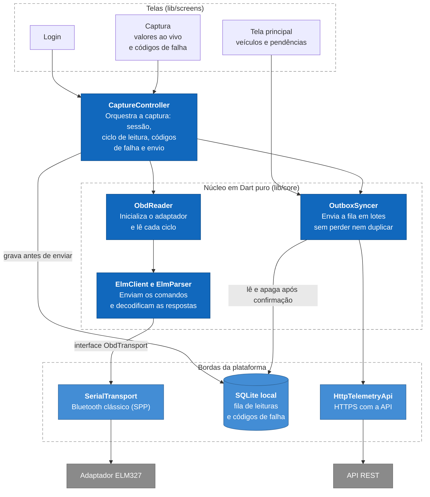

# Telemetria Automotiva Remota: App Android

[](https://github.com/SamuelMorsch/telemetria_obd2_app/actions/workflows/flutter_ci.yml)
[](https://sonarcloud.io/summary/new_code?id=SamuelMorsch_telemetria_obd2_app)
[](https://sonarcloud.io/summary/new_code?id=SamuelMorsch_telemetria_obd2_app)

Aplicativo do motorista. Lê o veículo pelo adaptador OBD-II (ELM327, Bluetooth clássico) e envia a
**tensão elétrica, a rotação, a velocidade, a temperatura e os códigos de falha** ao servidor da
oficina, em tempo real, **mesmo quando o sinal do celular some e volta** durante a viagem.

> Este é um dos três módulos do sistema. A visão geral, a arquitetura, os requisitos e o vídeo de
> demonstração estão no **[README principal](https://github.com/SamuelMorsch/telemetria-api)**.
> Os outros módulos são a [API](https://github.com/SamuelMorsch/telemetria-api) e o
> [painel web](https://github.com/SamuelMorsch/painel-telemetria-web).

## O que o app faz
- Entra com a conta da oficina e lista os veículos dela.
- Conecta ao adaptador OBD-II e lê os dados do carro ligado, cerca de **2,5 leituras por segundo**.
- Grava cada leitura no celular **antes** de enviar e só apaga depois que o servidor confirma.
- Continua capturando sem internet e retoma o envio sozinho quando o sinal volta.
- Lê os códigos de falha confirmados e pendentes e mostra o resultado na tela.
- Mostra o que ainda está pendente de envio ("Tudo enviado" quando não há nada).

## Como funciona



### O que é lido do carro

| Dado | Comando | Observação |
|---|---|---|
| Tensão no conector | `ATRV` | medida pelo próprio adaptador |
| Tensão da central | PID `01 42` | informada pela central eletrônica; gravada à parte, para comparar |
| Rotação | PID `01 0C` | |
| Velocidade | PID `01 0D` | |
| Temperatura do motor | PID `01 05` | lida a cada 10 ciclos, pois varia devagar |
| Códigos de falha | serviços `03` (confirmados) e `07` (pendentes) | a cada 30 s e sob demanda, no botão **Ler agora** |

Só são pedidos os PIDs que o carro informa suportar. Cada leitura tem número de sequência e horário,
o que permite à API descartar repetições (o reenvio nunca duplica dados).

### Falhas de rede
Tudo é gravado num banco SQLite local antes de ser enviado, em lotes. Erros do servidor viram três
ações: login expirado (pede novo login e preserva os dados), falha temporária (tenta de novo depois
e preserva os dados) e recusa definitiva (descarta só o item inválido).

> O SQLite aqui é só a **fila local do celular**. O banco do sistema é o PostgreSQL com TimescaleDB
> da API, e as diretrizes do curso permitem persistência local no dispositivo para o modo offline.

## Instalação e uso

**Você precisa de:** celular Android, adaptador OBD-II ELM327 **Bluetooth** (não Wi-Fi) e uma conta
de oficina no sistema.

1. **Instale o app.** O CI gera o APK de release a cada alteração: no GitHub, aba **Actions**,
   abra a execução mais recente da `main` e baixe o arquivo **app-release** em *Artifacts*. Para
   instalar, o Android pede para permitir "instalar apps desconhecidos". Ou compile você mesmo
   (veja abaixo).
2. **Pareie o adaptador** nas configurações de Bluetooth do Android. O nome costuma ser `OBDII`, e o
   PIN costuma ser `1234` ou `0000`.
3. Entre no app com a conta da oficina e escolha (ou cadastre) o veículo.
4. Ligue o carro com o adaptador na porta OBD-II, toque em **Escolher** e selecione o adaptador.
5. Toque em **Iniciar captura**. **Mantenha o app aberto:** a tela fica ligada durante a captura.

### Compilar
Requer Flutter 3.44 e JDK 17.

```bash
flutter pub get
flutter run                                   # em um celular conectado
flutter build apk --release                   # gera build/app/outputs/flutter-apk/app-release.apk
flutter run --dart-define=API_URL=https://meu-servidor   # para usar outro servidor
```
O servidor padrão é o do projeto, `https://telemetria-tcc.duckdns.org`.

## Permissões e privacidade
| Permissão | Para quê |
|---|---|
| Bluetooth (conectar e procurar) | falar com o adaptador OBD-II |
| Localização | o Android a exige para procurar dispositivos Bluetooth. **O app não lê nem envia a sua localização.** |
| Internet | enviar as leituras ao servidor da oficina |

## Testes e qualidade
```bash
flutter analyze
flutter test --coverage
```
Os testes não precisam de celular nem de adaptador: um adaptador de mentira devolve respostas
combinadas, **entregues em pedaços como o Bluetooth faz**. Eles cobrem a decodificação do ELM327
(redes CAN e antigas, mensagens longas, várias centrais), o leitor OBD, o controle da captura, a
fila e o cliente do servidor. A cada alteração, o CI roda a análise estática, os testes e a análise
do [SonarQube Cloud](https://sonarcloud.io/summary/new_code?id=SamuelMorsch_telemetria_obd2_app),
e compila o APK.

## Limitações conhecidas e próximos passos
- **A captura exige a tela ligada.** Ainda não há serviço em primeiro plano para capturar com a tela apagada.
- **Sem reconexão automática do Bluetooth:** se o adaptador se desconectar, é preciso reiniciar a captura.
- **Códigos de falha só do OBD-II padrão** (motor, câmbio e emissões). Falhas de freios, airbag e
  carroceria exigem protocolos de cada montadora e ficam de fora.
- Só Android. A comunicação com o adaptador usa Bluetooth clássico, que o iOS não oferece.
- O login fica no banco local do app, não em armazenamento criptografado do sistema, com validade
  curta no servidor (8 h). É um compromisso aceito para o escopo do TCC.

## Decisões de arquitetura
| ADR | Decisão |
|---|---|
| [0001](docs/adr/0001-app-nucleo-testavel-fila-local-e-bluetooth-isolado.md) | Núcleo testável em Dart puro, fila local e Bluetooth isolado |
| [0002](docs/adr/0002-plugin-bluetooth-mantido-no-repositorio.md) | Plugin Bluetooth mantido no repositório |
| [0003](docs/adr/0003-leitura-de-codigos-de-falha-isolada-da-captura.md) | Leitura de códigos de falha isolada da captura de tensão |

## Estrutura do código
| Pasta | O que há nela |
|---|---|
| `lib/core` | Núcleo em Dart puro: decodificação do ELM327, leitor OBD e fila de envio ([detalhes](lib/core/README.md)) |
| `lib/capture` | Controle da captura |
| `lib/data` | SQLite local e clientes do servidor |
| `lib/bluetooth` | Bluetooth, isolado atrás de uma interface |
| `lib/screens` | Telas |
| `third_party` | Plugin Bluetooth de terceiros (ver ADR 0002), fora da análise |
| `test` | Testes automatizados |

## Contribuindo
Veja [`CONTRIBUTING.md`](CONTRIBUTING.md).

## Declaração de uso de inteligência artificial
Ferramentas de IA generativa foram usadas como apoio na revisão de código, na documentação e na
estruturação de textos. As decisões de arquitetura, a validação dos resultados e a autoria do
projeto são do autor.

## Licença
[MIT](LICENSE) © 2026 Samuel Morsch. O plugin em `third_party` mantém a licença original (MIT).
